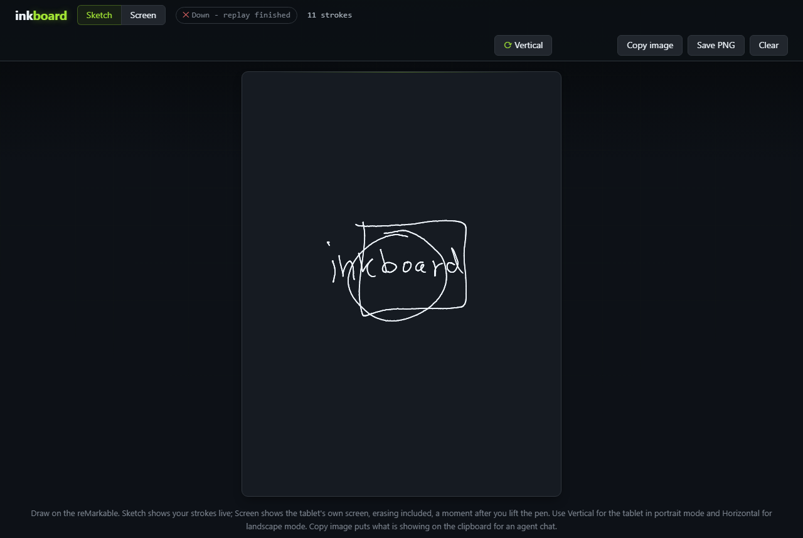

# inkboard

**Draw on your reMarkable 2, watch every stroke appear on your PC as you write, and paste the
drawing into an AI chat with one click.**

[](https://github.com/xanthar/ReMarkable-InkBoard/actions/workflows/ci.yml)
[](LICENSE)


inkboard is a live drawing board for the reMarkable 2. Every stroke you make with the pen appears
in a browser page on your PC while you write, and the page can also show the tablet's own screen a
moment after you lift the pen. One click copies the drawing as a PNG, ready to paste into Claude,
ChatGPT or any other chat that accepts images, where the AI can review your sketch or turn it into
Mermaid, text or code. Drawing an idea is often quicker than describing it, and inkboard removes
the steps between the tablet and the chat.

It installs nothing on the tablet to do this, serves the page on `127.0.0.1` only, and never logs
your handwriting. It uses the USB cable when it is plugged in and the tablet's Wi-Fi when it is
not, and it switches between the two by itself.



## Why you might want it

- **Sketch an idea and hand it to an AI.** Draw a flow, a rough architecture or a screen layout,
  press **Copy image**, paste it into the chat and ask for a review, a Mermaid diagram, a written
  description or code.
- **A whiteboard for calls.** The page is an ordinary browser tab, so you can share it in a video
  call and draw on the tablet while you talk; the others see each stroke as you make it.
- **The tablet on a bigger screen.** The Screen view shows the tablet as it is, with erasing,
  typed text and the menus, so you can show a page to someone at your desk.
- **A clean picture of a page.** **Copy image** and **Save PNG** export at the tablet's own
  resolution, and in the Screen view they can leave the tablet's toolbar out of the picture.
- **No cable needed, if you like.** With SSH over Wi-Fi turned on (an optional step), inkboard
  follows the tablet from the cable to the Wi-Fi and back without a reload.

## Try it without a tablet

With [uv](https://docs.astral.sh/uv/) and Git installed, we can play the pen recording that ships
with the tests. These four commands work in PowerShell and in a Linux or macOS shell:

```shell
git clone https://github.com/xanthar/ReMarkable-InkBoard.git
cd ReMarkable-InkBoard
uv sync --locked
uv run inkboard serve --source replay --replay tests/fixtures/rm2-sample.bin --loop
```

Then open <http://127.0.0.1:8000>. Sketch draws a circle, a square and the word "inkboard", and
Screen shows a synthetic test card. To connect your own tablet, the one-time setup over the USB
cable is in [Setting up the tablet](#setting-up-the-tablet).

**Project status.** inkboard 0.1.0 is built and used on Windows with a reMarkable 2 on firmware
3.24 and 3.29. The code is plain Python and its tests run on Linux and Windows, but live use on
Linux and macOS has not been tried yet, and the Wi-Fi search is available on Windows only. The
reMarkable 1 and the reMarkable Paper Pro have not been tested. Reports from other setups and pull
requests are welcome (see [CONTRIBUTING.md](CONTRIBUTING.md)).

> **Note:** inkboard is an independent project. It is not made, endorsed or supported by
> reMarkable AS, and "reMarkable" is their trademark. It uses the root SSH access that the
> reMarkable 2 offers to its owner; read [Security and privacy](#security-and-privacy) before
> you set it up.

## Contents

- [What inkboard does](#what-inkboard-does)
- [How it works](#how-it-works)
- [Security and privacy](#security-and-privacy)
- [Requirements](#requirements)
- [Installation](#installation)
- [Setting up the tablet](#setting-up-the-tablet)
- [Daily use](#daily-use)
- [The page](#the-page)
- [USB and Wi-Fi](#usb-and-wi-fi)
- [Commands](#commands)
- [Settings](#settings)
- [After a tablet firmware update](#after-a-tablet-firmware-update)
- [Removing inkboard](#removing-inkboard)
- [Troubleshooting](#troubleshooting)
- [Limitations](#limitations)
- [How it compares](#how-it-compares)
- [Development](#development)
- [Documentation](#documentation)
- [License](#license)

## What inkboard does

The page has two views of the tablet, and you switch between them with **Sketch | Screen**:

- **Sketch** draws your pen strokes the moment they happen, with the line width following the
  pen pressure. It shows only what the pen does, so it is instant, but erasing, selections, text
  and page turns are not part of it.
- **Screen** shows the tablet's own screen image a second or two after you lift the pen, exactly
  as the tablet shows it: erasing, selections, typed text and the menus included. It never reads
  the screen while you are writing, so the tablet's own ink stays smooth.

From either view, **Copy image** puts what is showing on the clipboard as a PNG that you can paste
straight into an AI chat, and **Save PNG** downloads the same image. Both images have the tablet's
screen size (1404 × 1872 pixels in portrait, 1872 × 1404 in landscape) and follow the
**Vertical / Horizontal** view you have chosen (see [The page](#the-page)).

The status chip at the top tells you how the page is connected, for example **Connected · USB**
or **Connected · Wi-Fi 192.168.1.42**, and, when something is wrong, what was tried and why it
failed.

## How it works

inkboard is a small Python web service (FastAPI) with a single static page, and it talks to the
tablet only through the SSH client that is already on your PC.

1. **The pen stream.** The reMarkable 2 exposes its digitizer as a Linux input device
   (`/dev/input/event1`). inkboard starts one long-running SSH session that runs `dd` on that
   device and reads the raw `input_event` records as they arrive. The records are decoded into
   pen strokes (touch down, movement with pressure, lift), turned upright for the page, gathered
   for about 16 ms and sent to the page over a WebSocket.
2. **The screen.** The tablet's app, `xochitl`, keeps the current screen image in its own memory.
   When the pen has rested, inkboard runs one short SSH command that first checks the firmware
   version and then copies that one frame out of the app's memory, compressed with `gzip`. The
   frame is checked for its exact size and full opacity before it is used, so a wrong read never
   reaches the page.
3. **The link.** Before every connection inkboard decides how to reach the tablet: over the USB
   cable when the PC has the cable network, otherwise over Wi-Fi at an address it remembers, an
   address you list, or one it finds by searching your local network for the tablet's network
   card. A watcher checks once a second, without sending anything, whether the cable is in, and
   moves the connection when that changes.

The design decisions behind each part are recorded in [`docs/adr/`](docs/adr/).

## Security and privacy

inkboard handles two sensitive things: your handwriting, and root access to your tablet. We
describe here what it does with each, so that you can decide whether its trade-offs suit you.

**The page stays on your PC.** The server always binds to `127.0.0.1`; there is no option to
serve it on the network. The WebSocket accepts connections only from the page's own origins
(`http://127.0.0.1:<port>` and `http://localhost:<port>`), the server refuses any other `Host`
header to stop DNS rebinding, and every response carries a strict Content Security Policy and
framing headers. Another website open in the same browser can therefore neither read your strokes
nor start a screen read.

**Handwriting is never logged.** The logs carry counts, identifiers, network addresses and ssh's
own messages, never handwriting: coordinates, pressure and screen frames are removed before
anything is written, and errors are printed without the values of local variables. A screen
frame is held in memory only while a page shows the Screen view, is never written to disk by the
server, and is served with `no-store` to the page's own same-origin request only. Handwriting
leaves your PC only when you press **Copy image** or **Save PNG**.

> **Note:** a screen image shows whatever is open on the tablet, including other notebooks and the
> file library with its thumbnails. Keep that in mind before you copy a screen image into a chat.

**Copy image uses the system clipboard.** If clipboard history is on (on Windows, Win+V), every
copied image stays in that history until you clear it, including Screen images. Save PNG writes to
your Downloads folder. The page never reads the clipboard.

**Nothing is installed on the tablet to draw or to read the screen.** inkboard only reads: the
pen device and one frame of the app's memory. Every remote command is fixed text built in code
from validated settings, never a free-form setting. inkboard starts its programs with an argument
list, never with text for a shell to parse; the only local commands it runs are two fixed Windows
reads for the opt-in Wi-Fi search (`arp.exe -a`, and a fixed `Get-NetAdapter` query through
`powershell.exe`).

**The SSH key.** inkboard runs SSH in batch mode, so the key it uses must not ask for a
passphrase. We recommend a separate key that is used only for the tablet and tied to a single host
entry in your SSH configuration, so that no other connection can use it. If you prefer a key with
a passphrase, load it into your SSH agent before you start inkboard. On Windows the OpenSSH agent
service is disabled by default; enable it once in an elevated PowerShell
(`Set-Service ssh-agent -StartupType Automatic; Start-Service ssh-agent`), then `ssh-add` the key.

**Over Wi-Fi, the tablet proves who it is first.** Every Wi-Fi connection is checked against the
host key stored under `remarkable` in `known_hosts` (`HostKeyAlias`,
`StrictHostKeyChecking=yes`), so SSH stops before the login key is offered if the device at that
address is not your tablet. inkboard never writes to `known_hosts`, and an address that fails the
check is skipped for ten minutes.

**Turning on SSH over Wi-Fi is a change on the tablet, and it is optional.** The firmware's own
switch opens port 22 on every Wi-Fi network the tablet joins, and by default the Wi-Fi listener
also accepts the root password. The setup below turns password login off for Wi-Fi only, so that
only your key works there, while the USB cable keeps password login as the way back in. Use
networks you trust; a guest or company network that isolates its devices will not work anyway.

**The network search is opt-in and quiet.** inkboard searches your network for the tablet only
after you have told it your tablet's Wi-Fi MAC (`INKBOARD_TABLET_MAC`); without it, inkboard
never searches and only tries the addresses the tablet reported and the ones you listed. Set it
only on networks you own or may scan. The search covers only the private networks of your PC's
physical adapters, up to 1,022 addresses, never a network that your VPN carries, and never while
the cable is in. It sends one small UDP packet to each address so that Windows learns the network
card addresses, and it contacts the SSH port only on the device whose network card matches your
tablet. It searches once when the tablet is lost, then after 5 and 15 minutes, and then once an
hour until the tablet is back, so a sleeping tablet causes at most one search an hour.

## Requirements

- **A reMarkable 2.** inkboard has been used on firmware **3.24** and **3.29** (the tablet shows
  its version under **Menu → Settings → Software → Version**). The pen stream needs only root
  SSH, which the reMarkable 2 offers, so it is likely to work on nearby versions too. The Screen
  view reads the screen at a measured memory offset and accepts only the firmware versions it was
  measured on, 3.24 and 3.29; on any other version Sketch keeps working and Screen says which
  version it found (see [After a tablet firmware update](#after-a-tablet-firmware-update)). The
  reMarkable 1 and the reMarkable Paper Pro have not been tested.
- **Windows 10 or later** with the built-in OpenSSH client
  (`C:\Windows\System32\OpenSSH\ssh.exe`; if it is missing, add **OpenSSH Client** under
  **Settings → Optional features**) and **PowerShell 7.3 or later** for the commands below
  (`winget install Microsoft.PowerShell`). inkboard is developed and used on Windows. On Linux and
  macOS the code uses your system `ssh`, and the test suite runs on Linux, but live use there has
  not been tried, and the Wi-Fi search is available on Windows only.
- **[uv](https://docs.astral.sh/uv/)** (`winget install astral-sh.uv`), which installs Python 3.13
  and the dependencies for you, and **Git** to clone the repository.
- **A current Chrome or Edge** for **Copy image**, which needs clipboard support for images. Any
  modern browser can use the page and **Save PNG**.
- **The USB cable, or the tablet and the PC on the same local network**, with SSH over Wi-Fi
  turned on (optional, see below).

## Installation

```powershell
git clone https://github.com/xanthar/ReMarkable-InkBoard.git
Set-Location ReMarkable-InkBoard
uv sync --locked
```

`uv sync --locked` creates a virtual environment in `.venv` and installs exactly the versions in
`uv.lock`. [Try it without a tablet](#try-it-without-a-tablet) shows the page with the recording
that ships with the tests.

## Setting up the tablet

The setup is done once, over the USB cable. We create a key, install it on the tablet, add one host
entry to the SSH configuration and check the pen settings. **With the cable only, steps 1–4 are
all you need.** Step 5, SSH over Wi-Fi, is optional and changes the tablet. Every command is
PowerShell 7.3 or later. The full runbook, with the values we measured and every check, is
[`docs/operations/device-setup.md`](docs/operations/device-setup.md).

### 1. Connect over USB and accept the host key

Plug the tablet in and wake it. The reMarkable 2 shows its root password under **Menu →
Settings → Help → Copyrights and licenses**, near the bottom of that page. The first login asks
you to accept the tablet's host key. We store it under the name `remarkable`, which every later
connection, over USB or Wi-Fi, is checked against:

```powershell
C:\Windows\System32\OpenSSH\ssh.exe -o HostKeyAlias=remarkable root@10.11.99.1 "uname -a"
```

### 2. Create a key for the tablet and install it

The first command creates a key without a passphrase (see [Security and
privacy](#security-and-privacy) for why), and the second proves that it has none, because it
prints the public key only when the passphrase is empty:

```powershell
C:\Windows\System32\OpenSSH\ssh-keygen.exe -t ed25519 -N '' -f $env:USERPROFILE\.ssh\id_ed25519_remarkable -C inkboard
C:\Windows\System32\OpenSSH\ssh-keygen.exe -y -P '' -f $env:USERPROFILE\.ssh\id_ed25519_remarkable
```

We then copy the public key to the tablet byte for byte and append it to `authorized_keys`,
removing any Windows line ending on the way:

```powershell
C:\Windows\System32\OpenSSH\scp.exe -o HostKeyAlias=remarkable $env:USERPROFILE\.ssh\id_ed25519_remarkable.pub root@10.11.99.1:/tmp/inkboard.pub
C:\Windows\System32\OpenSSH\ssh.exe -o HostKeyAlias=remarkable root@10.11.99.1 "mkdir -p ~/.ssh && chmod 700 ~/.ssh && tr -d '\r' < /tmp/inkboard.pub >> ~/.ssh/authorized_keys && chmod 600 ~/.ssh/authorized_keys && rm /tmp/inkboard.pub"
```

### 3. Add the host entry

The SSH configuration needs one host entry named `remarkable`. inkboard connects to that name,
and over Wi-Fi it supplies the address itself, so this one block covers both links:

```
Host remarkable
    HostName 10.11.99.1
    User root
    HostKeyAlias remarkable
    IdentityFile ~/.ssh/id_ed25519_remarkable
    IdentitiesOnly yes
```

On Windows the file is `$env:USERPROFILE\.ssh\config`, with no extension. These commands keep a
dated copy of an existing file and then append the block:

```powershell
$config = "$env:USERPROFILE\.ssh\config"
if (Test-Path $config) { Copy-Item $config "$config.backup-$(Get-Date -Format yyyy-MM-dd)" }
Add-Content -Path $config -Encoding utf8NoBOM -Value @'

Host remarkable
    HostName 10.11.99.1
    User root
    HostKeyAlias remarkable
    IdentityFile ~/.ssh/id_ed25519_remarkable
    IdentitiesOnly yes
'@
```

We check that key login works without a prompt:

```powershell
C:\Windows\System32\OpenSSH\ssh.exe -o BatchMode=yes remarkable "echo ok"
```

### 4. Check the pen settings

`inkboard probe` finds the pen device, measures the size of its input records and asks you to tap
the four corners of the screen, with the tablet in portrait, to work out how the pen axes map onto
the page:

```powershell
uv run inkboard probe
```

It ends with three lines. If they differ from the defaults in [Settings](#settings), put them in
your `.env` file. On the tablets we measured, the defaults were right.

### 5. Optional: SSH over Wi-Fi

Skip this step if you only use the cable. Turning on SSH over Wi-Fi changes the tablet, so we take
a full backup first.

1. **Back up the tablet.** `scripts/tablet_backup.py` copies everything on the tablet's storage to
   your PC and checks every part against hashes taken on the tablet. It only reads the tablet. It
   needs the raw size of the storage (about 7.7 GB) plus 5 GB free on the target drive, although
   the backup itself is about 440 MB. Keep the tablet awake for about ten minutes while it runs.

   ```powershell
   uv run python scripts/tablet_backup.py "$env:USERPROFILE\Backups\remarkable\$(Get-Date -Format yyyy-MM-dd)-before-wifi"
   ```

   > **Note:** the backup holds secrets, such as your Wi-Fi passwords, cloud tokens and the
   > tablet's SSH host keys, as well as every notebook. Keep it on your PC and never sync, share
   > or commit it. The script refuses a destination inside a git repository.

2. **Turn password login off for Wi-Fi only.** On the reMarkable 2 the Wi-Fi and USB SSH listeners
   share one systemd template, so a drop-in for Wi-Fi would also change USB. The repository ships a
   small unit file, [`contrib/dropbear-wlan@.service`](contrib/dropbear-wlan@.service), that
   replaces the template for Wi-Fi alone;
   [section D3b of the runbook](docs/operations/device-setup.md#d3b--ssh-over-wi-fi-optional-changes-the-tablet)
   installs it and proves that Wi-Fi changed and USB did not.

3. **Put the tablet on your Wi-Fi**, the same network as your PC: on the tablet, open **Menu →
   Settings → Wi-Fi**, pick the network and enter its password. Networks with a sign-in page
   (captive portals) do not work, and guest networks usually keep devices apart.

4. **Turn SSH over Wi-Fi on** with the firmware's own switch, then check the port at the tablet's
   Wi-Fi address. Your router shows that address, or the third command asks the tablet over the
   cable:

   ```powershell
   C:\Windows\System32\OpenSSH\ssh.exe -o BatchMode=yes remarkable 'rm-ssh-over-wlan on'
   Test-NetConnection <tablet address> -Port 22
   C:\Windows\System32\OpenSSH\ssh.exe -o BatchMode=yes remarkable 'ip -4 addr show wlan0'
   ```

5. **Tell inkboard the tablet's network card address** (its MAC address), which the search uses.
   Read it from the tablet:

   ```powershell
   C:\Windows\System32\OpenSSH\ssh.exe -o BatchMode=yes remarkable 'cat /sys/class/net/wlan0/address'
   ```

   Then create your `.env` in the repository folder (`Copy-Item .env.example .env`), remove the
   `#` in front of `INKBOARD_TABLET_MAC`, and put the address it printed after the `=`. A line
   that starts with `#` is ignored. `.env` is ignored by git.

A DHCP reservation for the tablet in your router keeps its address stable, but inkboard does not
need one: the tablet reports its Wi-Fi address while it is connected, and inkboard remembers it.

## Daily use

1. Wake the tablet. The USB cable is optional when SSH over Wi-Fi is on.
2. Start the server from the repository folder:

   ```powershell
   uv run inkboard serve
   ```

3. Open <http://127.0.0.1:8000>. Once the pen stream is up, the status chip shows
   **Connected · USB**, or **Connected · Wi-Fi** with the tablet's address.
4. Pick **Sketch** (instant, pen strokes only) or **Screen** (the tablet's own screen, a second
   or two behind), and draw.
5. To hand the drawing to an AI, press **Copy image** and paste it into the chat. In Claude Code
   in a Windows terminal, paste an image with **Alt+V**, because Ctrl+V pastes text only.
6. Stop the server with Ctrl+C.

When the tablet goes to sleep, the chip turns to **Down** and says why ("connection lost", then
"no answer (tablet asleep?)"). The server keeps trying by itself, and the strokes come back a few
seconds after the tablet wakes; Screen fetches a fresh picture then as well.

**Drawing on the page only.** If you want strokes on the page without ink in the notebook, pick
the selection tool on the tablet first. The pen still reports its movements, so Sketch draws them,
but the tablet leaves no ink. Screen shows the tablet as it is, so there you see the selection
lasso instead.

## The page

- **Sketch | Screen** chooses what the page shows. The choice is remembered per browser.
- **Vertical / Horizontal** matches the page to the tablet: Vertical for portrait, Horizontal for
  the tablet's landscape mode, which turns the picture so that it stays upright. The pen does not
  report how the tablet is held, so you set this yourself; in Screen, switching it also fetches a
  fresh picture. The choice is remembered per browser. On the tablet, landscape is set per
  document: open it, tap **Document settings** in the toolbar, then **Set to landscape**.
- **Copy image** puts what is showing on the clipboard as a PNG, and **Save PNG** downloads it.
  Sketch exports black ink on white as `inkboard-YYYY-MM-DD-HHMMSS.png`; Screen exports the
  tablet's own picture as `inkboard-screen-YYYY-MM-DD-HHMMSS.png`. Both buttons are greyed out
  while there is nothing to export. Copy image needs the page focused and opened as `127.0.0.1`
  or `localhost`.

In **Sketch**:

- **Clear** empties the page after a confirmation step; nothing on the tablet changes.
- The counter shows the number of strokes on the page.
- **Erasing shows as ink.** With the standard Marker you erase by picking the Eraser in the
  toolbar and using the pen tip, and the pen reports that as an ordinary stroke. Switch to Screen
  to see the erasure, or press Clear and draw again. The eraser end of the Marker Plus is reported
  as an eraser and is not drawn.
- **The toolbar with the pen tip draws a dot.** A tap on the tablet's toolbar with the pen is a
  short pen stroke, so Sketch shows a dot there; actions from the menus, such as erasing a
  selection, never reach Sketch.

In **Screen**:

- A new picture arrives a second or two after the pen lifts, never while you are writing.
  **Refresh** fetches one now, which you need after a page turn, a menu or anything else done with
  a finger, since fingers are not part of the pen stream.
- The text next to the chip says **Updating…**, the picture's time, or the error. After an error
  the last picture stays, dimmed.
- **Copy menu** is off by default: Copy image and Save PNG then paint the tablet's toolbar white,
  so that the AI sees only your page. inkboard recognises the toolbar from its icons, open or
  closed, in portrait or landscape, for the right-handed layout. When it cannot tell where the
  menu is (a pop-up, the file library, the left-handed layout), it keeps the menu and the notice
  says "menu kept".
- A hidden browser tab stops asking for pictures.

## USB and Wi-Fi

Before every connection inkboard tries, in this order:

1. **The USB cable** (`10.11.99.1`), when the PC has the cable network and the tablet answers.
2. **The tablet's last Wi-Fi address**: the address the tablet reported for itself while it was
   connected, and the last address that worked. Both are kept in a small `link.json`
   (`%LOCALAPPDATA%\inkboard\` on Windows, `$XDG_STATE_HOME/inkboard/` or
   `~/.local/state/inkboard/` elsewhere), and only private LAN addresses are accepted.
3. **The addresses in `INKBOARD_WIFI_ADDRESSES`**, in order.
4. **A search** of your PC's own network for the tablet's network card, only when you have set
   `INKBOARD_TABLET_MAC`, as described in [Security and privacy](#security-and-privacy). A search
   of a typical home network takes several seconds; when Windows already knows the tablet, the
   answer comes at once.

On a new network, plugging the cable in once is enough: the tablet then reports its Wi-Fi address,
and inkboard uses it the next time the cable is out.

Switching happens by itself. When you pull the cable, inkboard moves to Wi-Fi within about two
seconds. When you plug it back in, it moves back to the cable as soon as Windows has the cable
network up again, which can take up to half a minute after a replug. A stroke that you are
drawing during a switch simply ends, and nothing joins it to the next one.

When inkboard cannot reach the tablet, the chip lists what it tried, for example
`USB: cable not connected; 192.168.1.42: no answer (tablet asleep?); next Wi-Fi search in 5 min`.
A network larger than the search limit, a network carried by a VPN and a search that found
nothing are always named on the chip; inkboard never cuts a search short without saying so.

## Commands

| Command | What it does |
|---|---|
| `uv run inkboard serve` | the live page on `http://127.0.0.1:8000`; `--port` changes the port, `--event-size` the record size |
| `uv run inkboard serve --source replay --replay FILE` | plays a recording instead of the tablet (`--speed`, `--loop`); Screen shows a synthetic test card |
| `uv run inkboard record --seconds 30` | saves the raw pen stream (15 s by default) to `recordings/` (ignored by git), or to `--out FILE`, for a test or a bug report |
| `uv run inkboard probe` | finds the pen device, the record size and the orientation (`--wait`, `--tap-timeout`) |
| `uv run inkboard demo --out FILE` | writes a synthetic recording (`--event-size`) |
| `uv run python scripts/tablet_backup.py DEST` | backs up and verifies the whole tablet; `DEST --restore-test MEMBER` restores one file to `/tmp` on the tablet to prove the backup |

`probe`, `record` and `scripts/tablet_backup.py` use the host entry as written, which is the USB
cable; only `serve` chooses between USB and Wi-Fi.

While `serve` runs, `http://127.0.0.1:<port>/api/v1/health/live` answers 200, and
`/api/v1/health/ready` answers 200 with the link in use while the pen stream is connected, else
503 with the reason. A script or an agent can use them to check that the board is up.

## Settings

All settings are optional. Put the ones you need in a `.env` file in the folder you start
inkboard in (copy [`.env.example`](.env.example), which lists them all, and remove the `#` in front
of each line you set); real environment variables win over the file. Start inkboard from the
repository folder, or the file is not found. The defaults are the values measured on a
reMarkable 2.

| Variable | Default | Meaning |
|---|---|---|
| `INKBOARD_SSH_HOST` | `remarkable` | the host entry in `~/.ssh/config`: its user, key and known-hosts name; inkboard supplies the address (USB or Wi-Fi) itself |
| `INKBOARD_SSH_BIN` | `C:\Windows\System32\OpenSSH\ssh.exe` on Windows, `ssh` elsewhere | the SSH client |
| `INKBOARD_PEN_DEVICE` | `/dev/input/event1` | the pen input device on the tablet |
| `INKBOARD_EVENT_SIZE` | `16` | the size of one input record in bytes (16 or 24) |
| `INKBOARD_ORIENTATION` | `swap_xy,flip_y` | how the raw pen axes map onto the portrait page |
| `INKBOARD_BATCH_MS` | `16` | how long points are gathered before they are sent to the page (4–100) |
| `INKBOARD_PORT` | `8000` | the page port, 1024–65535 (`serve --port` overrides it); the server always binds to `127.0.0.1` |
| `INKBOARD_WIFI_ADDRESSES` | empty | Wi-Fi addresses to try, comma-separated (private LAN addresses only, at most 16) |
| `INKBOARD_TABLET_MAC` | none | your tablet's Wi-Fi network card address; without it inkboard never searches your network |

To make inkboard forget the tablet's Wi-Fi address, delete `link.json` (see
[USB and Wi-Fi](#usb-and-wi-fi) for where it is).

## After a tablet firmware update

A firmware update can change four things that inkboard depends on, so we check them over the
cable before trusting live use. The runbook has the full list and its order. The tablet updates
itself by default; to choose when it updates, turn automatic updates off under **Menu → Settings →
Software → Version** and update from the same screen when you have time for these checks.

1. **The SSH host key.** An update can replace it. The chip then says `Down - Host key
   verification failed. (retrying)`, and your own `ssh` says `REMOTE HOST IDENTIFICATION HAS
   CHANGED`. Confirm over the cable that it really is your tablet, then replace the stored key:

   ```powershell
   C:\Windows\System32\OpenSSH\ssh-keygen.exe -R remarkable
   C:\Windows\System32\OpenSSH\ssh.exe -o StrictHostKeyChecking=accept-new remarkable "echo ok"
   ```

2. **The pen settings.** Run `uv run inkboard probe` and compare its three lines with the defaults.
3. **The screen offset.** The Screen view refuses a firmware version it was not measured on.
   Section D7 of the runbook shows how to measure a new version, which only reads the tablet.
4. **Password login over Wi-Fi.** An update replaces the tablet's system files, which removes the
   Wi-Fi unit file, while the Wi-Fi switch itself survives in the user data. SSH over Wi-Fi then
   comes back **with password login on**. Turn SSH over Wi-Fi off first (`rm-ssh-over-wlan off`),
   take a new backup (runbook D8), then install `contrib/dropbear-wlan@.service` again and prove it
   (runbook D3b, steps 1–2) before you turn it back on.

## Removing inkboard

On the PC, inkboard is the repository folder and, once it has seen the tablet on Wi-Fi, a small
`link.json` (see [USB and Wi-Fi](#usb-and-wi-fi)); deleting both removes it. The changes the setup
made, on the PC and on the tablet, are undone step by step in the runbook's
[Rollback](docs/operations/device-setup.md#rollback): SSH over Wi-Fi, the key on the tablet, the
host entry and the key pair on the PC.

## Troubleshooting

| What you see | Cause | What to do |
|---|---|---|
| Chip `Down - connection lost (retrying)` | the connection ended: cable out, tablet asleep or Wi-Fi gone | nothing; inkboard tries USB, then Wi-Fi. Wake the tablet if it slept |
| Chip `Down - ssh client not found: …` | Windows' OpenSSH Client is not installed, or `INKBOARD_SSH_BIN` points to a missing file | add **OpenSSH Client** under **Settings → Optional features**, then start `serve` again |
| Chip `Down - Host key verification failed. (retrying)` | the tablet's SSH host key changed, usually after a firmware update | confirm over the cable that it is your tablet, then follow [After a tablet firmware update](#after-a-tablet-firmware-update), step 1 |
| Chip `… no answer (tablet asleep?)` | the tablet is asleep | wake it |
| Chip `… no Wi-Fi search while the USB cable is in` | the cable is in, so inkboard does not search | wake the tablet; it connects over the cable |
| Chip `… Wi-Fi search off - set INKBOARD_TABLET_MAC` | no tablet MAC is set, so inkboard does not search | set it in `.env` ([setup step 5](#5-optional-ssh-over-wi-fi)), list the address in `INKBOARD_WIFI_ADDRESSES`, or plug in once |
| Chip `… tablet not found (guest or company Wi-Fi may block devices from reaching each other)` | client isolation, the tablet on another network, or the tablet asleep on a network inkboard has not seen it on | plug in once, or use the cable |
| Chip `… too large to search` | your network has more than 1,022 addresses | plug in once, or set `INKBOARD_WIFI_ADDRESSES` |
| Chip `… routed through a VPN, not searched` | your VPN carries the local network's traffic | turn the VPN off, or plug in |
| Chip `… SSH over Wi-Fi may be off on the tablet` | SSH over Wi-Fi is off | see [step 5 of the setup](#5-optional-ssh-over-wi-fi) |
| Chip `… different SSH host key` | another device has the tablet's old address, or a firmware update changed the key; the login key was not offered | plug in, and see [After a tablet firmware update](#after-a-tablet-firmware-update) |
| Cable back in, but the chip stays on Wi-Fi for a while | Windows is bringing the cable network back | wait up to half a minute |
| `Permission denied (publickey)` | the key is not on the tablet, or another key is used | redo setup step 2; `ssh -G remarkable` shows which key is used |
| `ssh root@10.11.99.1` asks for a password | the key belongs to the `remarkable` entry | use `ssh remarkable` |
| Connected, but nothing draws | wrong input device | run `uv run inkboard probe` and set `INKBOARD_PEN_DEVICE` |
| `frame misalignment` | wrong record size or device | run `uv run inkboard probe` and set `INKBOARD_EVENT_SIZE` |
| Strokes turned or mirrored | the page view does not match the tablet, or the orientation is wrong | switch Vertical / Horizontal; otherwise run `probe` |
| `Screen: Screen view supports firmware …` | a firmware version that was never measured | measure it (runbook section D7) |
| The page stays on "Starting…" after an update | the browser kept an old script | reload with Ctrl+Shift+R |
| Pasting into Claude Code in a terminal does nothing | on Windows, Ctrl+V pastes text only | press Alt+V |

The runbook has the full table, with every chip and Screen message.

## Limitations

- **Sketch shows only the pen.** Erasing with the standard Marker, selections, moved content, text
  and page turns appear only in Screen.
- **Screen is not live video.** It shows a picture after the pen rests, and each picture takes
  about 0.8–1 s, because each one is a new SSH connection: the Windows SSH client cannot share one
  connection between runs. Live video would need a helper installed on the tablet, which inkboard
  deliberately avoids.
- **The screen offset is a measurement, not an interface.** A firmware update can move it, and
  Screen then refuses until it is measured again. Sketch keeps working.
- **The toolbar is recognised for the right-handed layout only.** Other layouts keep the menu in
  the exported image, and the notice says so.
- **One user, one PC.** There is no login, because the page never leaves `127.0.0.1`.

## How it compares

Several good tools show a reMarkable on a computer, and inkboard builds on what their authors
found. inkboard is the one to pick when you want to hand a sketch to an AI chat from Windows
without installing anything on the tablet. If you want smooth live video of the screen,
goMarkableStream or reStream suit you better; for live strokes on Linux or macOS, pipes and paper
enhanced is tested there. Each row below is taken from that project's own README.

| Project | What you see | On the tablet | Getting an image out |
|---|---|---|---|
| **inkboard** | live pen strokes, and the tablet's own screen after the pen lifts | nothing installed | Copy image to the clipboard, Save PNG |
| [pipes and paper enhanced](https://github.com/Pyrrhu5/pipes-and-paper-enhanced) | live pen strokes in a browser (Linux, macOS) | nothing installed | not described |
| [goMarkableStream](https://github.com/owulveryck/goMarkableStream) | a live stream of the screen in a browser | a server binary that runs on the tablet | not described |
| [reStream](https://github.com/rien/reStream) | live screen video in a window, recording, a virtual webcam | a small `restream` binary | video recording |
| [reSnap](https://github.com/cloudsftp/reSnap) | a screenshot on demand | nothing required (an optional `lz4` binary) | a file, or the clipboard |

The screen offset inkboard reads was first found by the
[goMarkableStream](https://github.com/owulveryck/goMarkableStream/issues/140) and
[reSnap](https://github.com/cloudsftp/reSnap/pull/27) communities (ADR 0002); inkboard measured it
on its own and shares no code with either project.

## Development

The project uses uv, Ruff, mypy in strict mode, pytest with a 98% coverage floor, Bandit,
pip-audit and gitleaks; the first gate needs Node.js and the last the
[gitleaks](https://github.com/gitleaks/gitleaks) binary. Run these gates before you commit. CI runs
them on every push and pull request, the tests on Linux and Windows, together with osv-scanner, and
CodeQL on the public repository. [CONTRIBUTING.md](CONTRIBUTING.md) has the details.

```powershell
node --check src\inkboard\static\app.js
uv run ruff format --check .
uv run ruff check .
uv run mypy src/ scripts/
uv run pytest -q --maxfail=1 --cov=inkboard --cov-fail-under=98
uv run bandit -c pyproject.toml -r src/ scripts/ -ll -ii
uv run pip-audit
uv export --locked --format requirements-txt --no-emit-project -q -o $env:TEMP\inkboard-lock-export.txt
uv run pip-audit -r $env:TEMP\inkboard-lock-export.txt --require-hashes --disable-pip
Remove-Item $env:TEMP\inkboard-lock-export.txt
gitleaks git . --config .gitleaks.toml --redact --no-banner
```

The tests need no tablet and no network. A fake device stands in for SSH, a real recording
(`tests/fixtures/rm2-sample.bin`) pins the decoder and the orientation, and the link and search
tests fail on any real network use or child process.

| Path | What it holds |
|---|---|
| `src/inkboard/services/events.py` | decoding of the raw `input_event` records |
| `src/inkboard/services/strokes.py` | turning events into strokes: touch, hover, pressure, recovery after dropped events |
| `src/inkboard/services/sources.py` | the SSH pen stream and the replay source |
| `src/inkboard/services/link.py`, `discovery.py` | choosing USB or Wi-Fi, the cable watcher and the network search |
| `src/inkboard/services/screen.py` | the screen read, its checks and the toolbar recognition |
| `src/inkboard/services/hub.py` | page state and the WebSocket protocol |
| `src/inkboard/app.py`, `cli.py` | the web app with its security headers, and the commands |
| `src/inkboard/static/` | the page: one HTML file, one script and one stylesheet, nothing loaded from the internet |
| `scripts/tablet_backup.py` | the verified tablet backup |
| `contrib/` | the Wi-Fi-only SSH unit file for the tablet |
| `tests/` | the test suite, the fake device and the fixtures |

## Documentation

- [`docs/architecture.md`](docs/architecture.md): how the pieces fit, the exact export formats and
  the rules the code keeps.
- [`docs/operations/device-setup.md`](docs/operations/device-setup.md): the full tablet runbook,
  the measured values, the backup, the complete troubleshooting table and the rollback.
- [`docs/adr/`](docs/adr/): the decisions behind the pen stream, the screen read and the USB or
  Wi-Fi link.
- [`CONTRIBUTING.md`](CONTRIBUTING.md), [`SECURITY.md`](SECURITY.md),
  [`CODE_OF_CONDUCT.md`](CODE_OF_CONDUCT.md): how to contribute, report a problem, and take part.
- [`CHANGELOG.md`](CHANGELOG.md): what changed. [`ROADMAP.md`](ROADMAP.md): what comes next, what
  is parked, and why.
- [`CLAUDE.md`](CLAUDE.md): the contract for contributors and AI coding agents.

## License

inkboard is released under the [MIT License](LICENSE).
